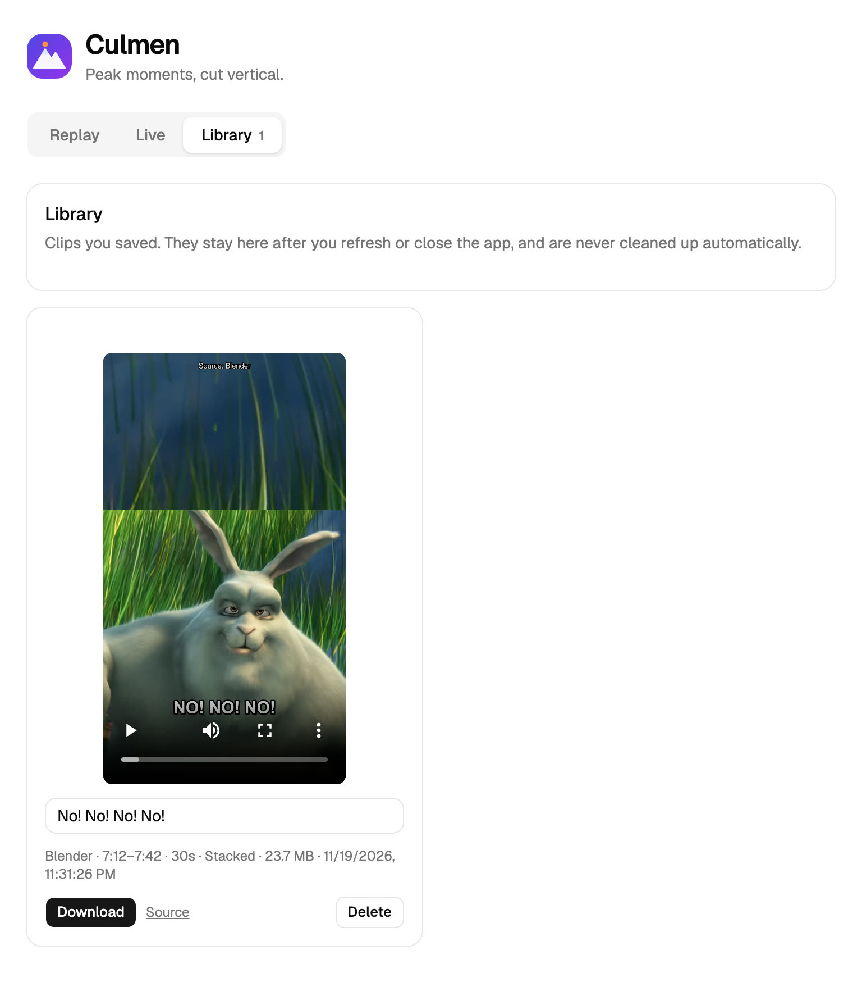
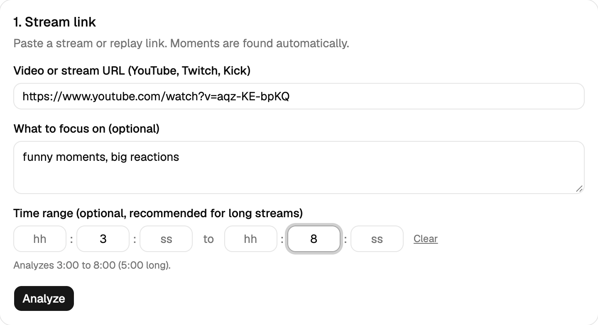
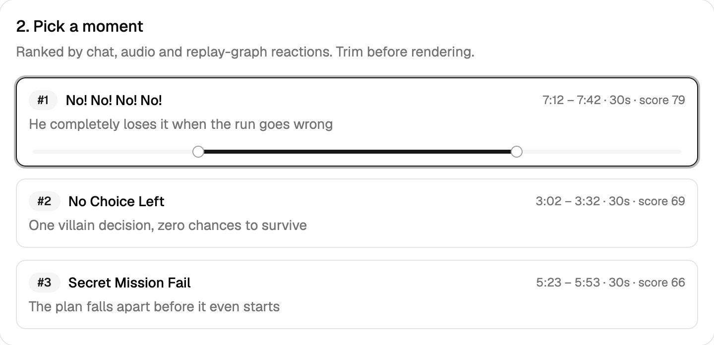
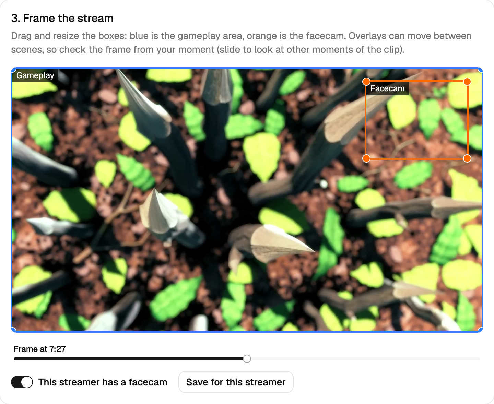
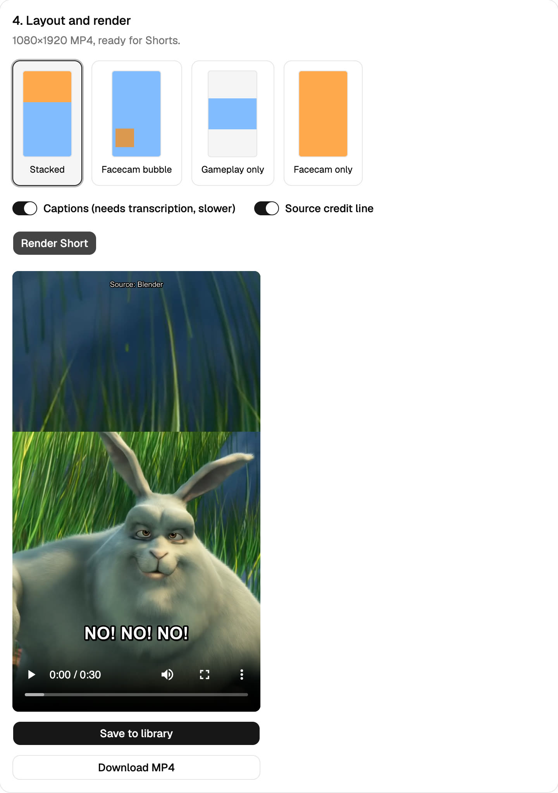
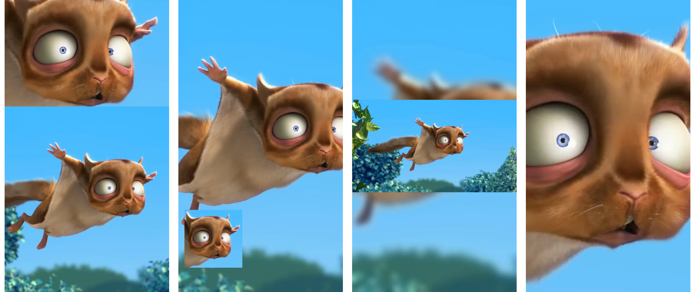
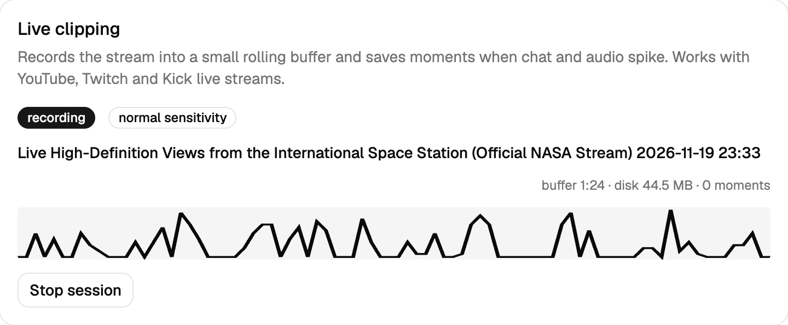
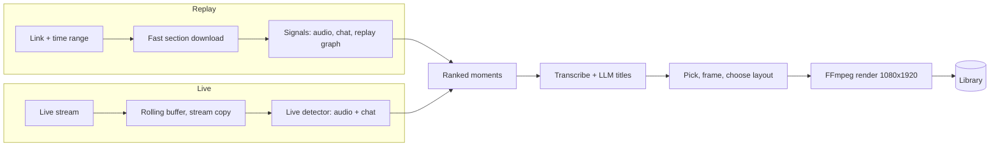

<p align="center">
  
</p>

<h1 align="center">Culmen</h1>

<p align="center"><strong>Peak moments, cut vertical.</strong><br>
Find the best moments of gaming streams, replays <em>and</em> live, and turn them into 1080×1920 Shorts.</p>

<p align="center">
  
  
  
  
  
</p>

<p align="center">
  <a href="#features">Features</a> ·
  <a href="#screenshots">Screenshots</a> ·
  <a href="#quick-start">Quick start</a> ·
  <a href="#how-it-works">How it works</a> ·
  <a href="#configuration">Configuration</a> ·
  <a href="#platform-support--status">Status</a> ·
  <a href="#limitations">Limitations</a> ·
  <a href="#contributing">Contributing</a>
</p>

<p align="center">
  
</p>

*Culmen* is Latin for "peak" or "summit": the thing this tool hunts for.

Culmen is a local, self-hosted web app. Paste a stream or replay link (YouTube, Twitch, Kick), pick the
part you care about, and it finds the moments where chat, audio and the YouTube replay graph spike. You frame
the gameplay and the streamer's facecam once, choose a layout, and render a Short with captions. It can also record
a **live** stream into a small rolling buffer and save moments as they happen.

> Built to be fast on long streams: a 5-minute 1080p60 section of a 9-hour video downloads in about 30 seconds,
> and 10 candidate moments are transcribed and ranked in about a minute on Apple Silicon.

## Features

- **Replay analysis.** Paste a link and an optional time range (hours : minutes : seconds). Moments are scored from
  chat spikes (distinct chatters, so one spammer doesn't count), audio loudness, and YouTube's "most replayed" graph.
- **Live clipping.** Records a live stream with ffmpeg stream copy (no re-encode, source quality) into a rolling buffer,
  watches chat and audio, and saves a moment when both react. You approve and render; nothing posts automatically.
- **Fast section download.** Only the time range you asked for is fetched, using the video's segment index and parallel
  chunked requests (see [How it works](#how-it-works)). Falls back to slower paths when a video can't be cut that way.
- **Bring your own LLM.** Any OpenAI-compatible endpoint writes titles and hooks and re-ranks candidates using the
  transcript. Entirely optional: without it, ranking uses the signals alone.
- **Facecam and gameplay framing.** Drag two boxes on a frame from the moment you picked (with a scrubber, because
  streamers move their overlays between scenes). Boxes are remembered per streamer.
- **Four layouts.** Stacked, facecam bubble, gameplay only (blurred background), facecam only. Word-by-word captions
  (Whisper) and an optional source-credit line.
- **Library.** Save the clips you like; they survive refreshes and restarts.
- **Sensitivity control for live.** Low / Normal / High, for streams that are loud all the time.
- **Local and private.** Everything runs on your machine. Your LLM key stays in a local `.env`.

## Screenshots

| 1. Paste a link and a range | 2. Pick a moment |
|---|---|
|  |  |

| 3. Frame the facecam and gameplay | 4. Choose a layout and render |
|---|---|
|  |  |

**Layouts** (the same moment, four ways):



**Live clipping**, recording a real stream with a rolling buffer, live score line and moments as they happen:



*The demo video is the open movie [Big Buck Bunny](https://peach.blender.org/) (© Blender Foundation, CC BY 3.0);
the live example is NASA's public ISS camera feed.*

## Quick start

**You need:** ffmpeg, Python 3.12+ with [uv](https://docs.astral.sh/uv/), and Node 20+.

```bash
brew install ffmpeg-full        # macOS; ffmpeg-full includes libass, which captions need
git clone https://github.com/HarshVirani914/culmen.git
cd culmen
cp .env.example .env            # optional: add an OpenAI-compatible LLM
./run.sh                        # builds the UI, installs the backend, serves http://localhost:8000
```

Open <http://localhost:8000>.

- **Replay tab:** paste a link, optionally set a time range, press **Analyze**, pick a moment, frame it, render.
- **Live tab:** paste a live stream link, press **Start live session**, and moments appear as they happen.
- **Library tab:** the clips you saved.

Apple Silicon Macs transcribe on the GPU with MLX Whisper automatically. Other machines use faster-whisper on the
CPU, which works but is much slower (see [Performance](#performance)).

## How it works



**Detection.** Replays combine three per-second signals: loudness spikes against a rolling baseline, the number of
*distinct chatters* per second (from the chat replay), and YouTube's replay graph. Peaks above the stream's own baseline
become 30-second windows that never overlap; if a stream is loud all the time and nothing stands out, the best few
are still returned. Live uses the same ideas with an adaptive threshold, a 12-second post-roll so the reaction is in the
clip, a cooldown between moments and an hourly cap.

**Fast section download.** yt-dlp cuts a section by giving the URL to ffmpeg, which reads it over one throttled
connection (about 0.6× realtime). YouTube's DASH mp4 files carry a `sidx` index listing the byte size of every
few-second segment, so Culmen computes which bytes cover your range, fetches only those with parallel chunked
requests, and joins video and audio locally. The cut snaps outward to segment boundaries (a few seconds), and the
app accounts for that in the timestamps.

**Live recording.** ffmpeg copies the stream into 6-second segments (no re-encode, so quality equals the source) and
a janitor keeps only the last N minutes (default 12, about 700 MB for 1080p). When a spike fires, the needed
segments are protected, stitched into a clip, and become an ordinary job, so framing, trimming and rendering work
exactly as for replays. Saved moments are capped (default 3 GB); anything you opened or rendered is never deleted.

**Rendering.** One FFmpeg filter graph per layout (crop, cover-fit scale, stack or overlay), x264 `medium` at CRF 18,
captions burned in from an ASS file.

### Performance

Measured on an Apple Silicon MacBook; your numbers will differ.

| Task | Result |
|---|---|
| 5 min of 1080p60 cut from a 9 h 45 min video | **34 s** (127 MB). The old ffmpeg section route ran at about 0.6× realtime. |
| 60 s section of a 2 h 45 min video | 14 s |
| Transcribe and LLM-rank 10 candidate moments | about **1 min** with MLX Whisper (large-v3-turbo) versus about 20 min with CPU Whisper small |
| Live recording buffer | about 1 MB/s for a 1080p stream |

## Configuration

Everything is optional. Set values in `.env` (copy `.env.example`) or the environment.

| Variable | Default | What it does |
|---|---|---|
| `LLM_BASE_URL`, `LLM_API_KEY`, `LLM_MODEL` | unset | An OpenAI-compatible chat endpoint for titles, hooks and re-ranking. All three must be set. |
| `CLIPPER_DATA_DIR` | `./data` | Where downloads, renders, the library and saved boxes live. |
| `CLIPPER_LIVE_BUFFER_SECONDS` | `720` | Length of the live rolling buffer. |
| `CLIPPER_LIVE_CAP_GB` | `3` | Cap on saved live moments (oldest unopened go first). |
| `WHISPER_BACKEND` | auto | `mlx` or `faster`. Auto picks MLX on Apple Silicon. |
| `FFMPEG_BIN` | auto | Path to an ffmpeg with libass if you need to override detection. |
| `YTDLP_COOKIES_FILE` | `data/youtube_cookies.txt` | Optional YouTube cookies, see below. |

### If YouTube says "Sign in to confirm you're not a bot"

Heavy use can trigger this. You can export the login cookies of a **throwaway** YouTube account (never your main one):
sign in to youtube.com in a browser profile, **quit that browser completely**, then run:

```bash
cd backend && uv run python -m app.cookies brave "Profile 1"   # your browser and profile name
```

Only YouTube and Google cookies are saved, to a private, git-ignored file. Every request uses a throwaway copy, so
YouTube's cookie rotation can't damage the saved file. Don't use that account in a browser while Culmen runs.
Automated use can get the account flagged.

## Platform support & status

What has actually been tested, versus what is only expected to work:

| Platform | Replay | Live | Chat |
|---|---|---|---|
| **YouTube** | ✅ analysis, section download, ranking | ✅ recording and moments | ✅ chat replay and live chat |
| **Twitch** | links accepted, ⚠️ not tested | ✅ recording, chat, moments, render | ✅ live (anonymous IRC); ❌ no replay chat |
| **Kick** | links accepted, ⚠️ not tested | ⚠️ not tested (no live channel was available) | ⚠️ best effort, unverified |

When chat isn't available, Culmen falls back to audio alone and the UI says so.

## Limitations

- **Replays of streams that just ended** are "post-live" on YouTube and can't be cut until YouTube finishes processing
  them (usually a few hours). Culmen says so instead of failing.
- **YouTube is moving clients to SABR-only streaming**, which hides direct download links. The fast section path still
  worked in testing, but if it stops, downloads silently fall back to slower paths.
- **Facecam position is drawn by you**, once per scene layout. There's no automatic facecam detection yet.
- **Not tested:** Kick (live and chat), Twitch VODs, Twitch ad breaks inside a live buffer.
- One live session at a time. A live session doesn't survive an app restart (saved moments do).
- No authentication. Run it on your own machine; don't expose the port to a network.
- Detection works on audio, chat and the replay graph. It doesn't *watch* the gameplay.
- Transcription quality depends on the language and the model; short or noisy clips can produce poor titles.

## Responsible use

Clipping other creators' streams can lead to copyright claims, strikes or demonetization on the platform you post to.
Captions, commentary and the source-credit option help but don't remove the risk. Get permission, or clip your own
content. Respect each platform's terms of service. Culmen does not upload or post anything.

## Project layout

```
backend/app/
  main.py            FastAPI routes
  pipeline.py        analyze and render jobs
  download.py        URL allowlist, yt-dlp, download paths
  sections.py        sidx-based fast section downloader
  signals.py         audio, chat and replay-graph scoring
  candidates.py      moment windows from a score
  transcribe.py      MLX / faster-whisper backends
  llm.py             OpenAI-compatible titles and ranking
  layouts.py         FFmpeg filter graphs   render.py  encoding
  library.py         saved clips            cookies.py  optional YouTube cookies
  live/              recorder, buffer, detector, chat clients, session
frontend/src/        React + Vite + Tailwind + shadcn/ui
docs/                design docs, plans, screenshots
```

## Development

```bash
cd backend  && uv run pytest        # about 2 minutes; some tests run real ffmpeg
cd frontend && npx vitest run       # frontend helpers
cd frontend && npm run dev          # dev UI on :5173, proxies /api to :8000
```

Design notes and implementation plans are in [`docs/`](docs/).

## Roadmap

- Automatic facecam detection to pre-place the box
- "Recent analyses" list to reopen past work after a refresh
- Visible note of which download path was used (fast, whole file, slow)
- Multiple simultaneous live sessions
- Kick and Twitch VOD verification
- Optional auto-render for live moments (the setting exists but does nothing yet)
- Posting to platforms (deliberately not built yet)

## Contributing

Issues and pull requests are welcome. Read [CONTRIBUTING.md](CONTRIBUTING.md) first. Please write the failing test first,
and don't include other people's content in screenshots or fixtures.

## Acknowledgements

Culmen stands on [yt-dlp](https://github.com/yt-dlp/yt-dlp), [FFmpeg](https://ffmpeg.org/),
[MLX Whisper](https://github.com/ml-explore/mlx-examples/tree/main/whisper) and
[faster-whisper](https://github.com/SYSTRAN/faster-whisper), [FastAPI](https://fastapi.tiangolo.com/),
[React](https://react.dev/), [Vite](https://vite.dev/), [Tailwind CSS](https://tailwindcss.com/) and
[shadcn/ui](https://ui.shadcn.com/). Several live-clipping details (Twitch chat over anonymous IRC, recording flags,
trigger rules) were informed by reading [PeakCut](https://github.com/haziqahmedqasmi/PeakCut) (MIT); no code was copied.

## License

[MIT](LICENSE)
